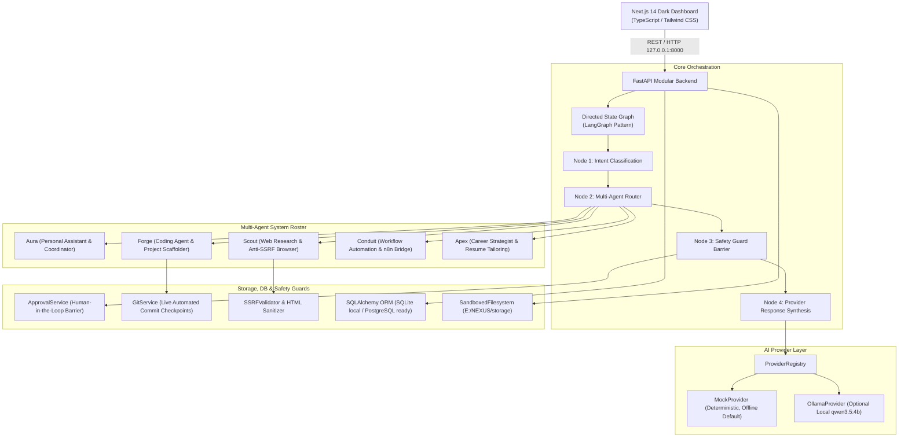

# NEXUS AI — Personal AI Operating System

[](https://www.python.org/)
[](https://fastapi.tiangolo.com/)
[](https://nextjs.org/)
[](https://www.typescriptlang.org/)
[](https://tailwindcss.com/)
[](https://docs.pytest.org/)
[](LICENSE)

NEXUS AI is a modular, local-first, multi-agent personal AI automation operating system engineered for digital activities, research, code development, communications, and task workflows. 

Designed from the ground up to operate with **zero hard dependencies**, NEXUS boots and runs in 100% offline standalone mode without requiring Ollama, PostgreSQL, or n8n, while providing seamless, non-blocking plug-in adapters when external services are connected.

---

## Table of Contents
1. [Key Architectural Principles](#key-architectural-principles)
2. [System Architecture & Topology](#system-architecture--topology)
3. [Multi-Agent Orchestration Roster](#multi-agent-orchestration-roster)
4. [The 13 Core Modules & Functions](#the-13-core-modules--functions)
5. [Security & Human-in-the-Loop Safety Barriers](#security--human-in-the-loop-safety-barriers)
6. [Database & Persistence Architecture](#database--persistence-architecture)
7. [Installation & Windows PowerShell Execution](#installation--windows-powershell-execution)
8. [Automated Verification & Test Suite](#automated-verification--test-suite)
9. [REST API Reference Summary](#rest-api-reference-summary)
10. [Repository Structure](#repository-structure)

---

## Key Architectural Principles

1. **100% Dependency Independence**:
   - Boots and runs instantly in offline standalone mode.
   - Built on an abstract `BaseLLMProvider` with an instant, deterministic `MockProvider` active by default (`nexus-mock-engine-v1`).
   - Optional local GPU inference via `OllamaProvider` (`qwen3.5:4b`) probed non-blockingly without delaying startup.
2. **Deterministic Safety Barriers**:
   - Consequential operations (transmitting emails, outbound messaging, deleting files, trigger pipelines) strictly require human operator authorization before execution.
   - Outputs are strictly segregated: NEXUS never claims an action was executed merely because a model recommended it (`claimed_actions_executed: false`).
3. **Sandboxed Filesystem Security**:
   - File read/write operations are confined to approved compartments inside `E:\NEXUS\storage`. Any path traversal outside authorized roots raises a `SecurityViolationError`.
4. **Least-Privilege Agent Governance**:
   - Agents possess fixed capability and permission scopes. The `SkillsRegistry` prevents agents from elevating their own permissions or invoking unapproved skills.
5. **Windows-First Optimization**:
   - Tuned for constrained local hardware (NVIDIA RTX 3050 4 GB VRAM, 16 GB RAM, 512 GB SSD) with low-overhead asynchronous execution.

---

## System Architecture & Topology



---

## Multi-Agent Orchestration Roster

| Agent ID | Persona Name | Role | Primary Capabilities | Permission Scopes |
|---|---|---|---|---|
| `personal_agent` | **Aura** | Personal Assistant & Coordinator | Dialogue, task dispatch, daily briefings, schedule synthesis | `read:profile`, `read:tasks`, `write:tasks` |
| `research_agent` | **Scout** | Web & Document Researcher | Anti-SSRF web reading, HTML sanitization, dossier archiving | `read:storage/documents`, `network:outbound_readonly` |
| `coding_agent` | **Forge** | Software Development & Scaffolding | Code analysis, project scaffolding, automated Git checkpoints | `read:approved_projects`, `write:approved_projects` |
| `workflow_agent` | **Conduit** | Workflow Automation & n8n Bridge | Triggering configured n8n webhooks, execution run monitoring | `invoke:n8n_webhooks` |
| `career_agent` | **Apex** | Career Strategist & Resume Tailoring | Job discovery, dynamic CV tailoring, quarantined outreach | `read:profile`, `write:storage/generated` |

---

## The 13 Core Modules & Functions

### 1. Personal Assistant & Conversational Interface
- Multi-turn state graph routing with real-time execution step telemetry.
- Expandable **State Graph Execution Trace** accordion in the UI showing intent classifications, routed agents, and safety boundary decisions.

### 2. Long-Term Memory & Personalized User Profile
- Two-tier memory architecture: user profiles in `storage/profile/system_user.md` and structured key-value memories in SQLite/PostgreSQL.
- `MemoryConsolidator` automatically scans chat turns and extracts developer directives, stack preferences, and operating rules.

### 3. Email & Calendar Management
- Quarantined email drafting service (`CommunicationService`).
- Outbound dispatch is locked until operator grants approval via Mission Control.
- Calendar agenda and event drafting with ISO 8601 validation.

### 4. Messaging & Communication Workflows
- Multi-channel outbound messaging queue (LinkedIn, Slack).
- Operator review interface prevents unauthorized external transmissions.

### 5. Task Scheduling, Reminders & Daily Briefings
- `BriefingService` compiles operational diagnostics, pending approvals, task pipeline, and agent activity.
- Automatically generates and saves markdown reports to `storage/generated/daily_briefing_<timestamp>.md`.
- Scheduled reminders endpoint (`/api/v1/briefings/reminders`) surfaces critical tasks and approval requests.

### 6. Browser & Web Research Agent
- `SandboxedWebReader` equipped with `SSRFValidator` to block internal, loopback, and link-local destinations (`localhost`, `127.0.0.1`, `169.254.169.254`, IPv6 `::1`, RFC 1918 subnets).
- `UntrustedHTMLSanitizer` purges `<script>`, `<style>`, `<iframe>`, inline event handlers, and `javascript:` URIs.
- Autonomous dossier compilation by Scout saved to `storage/documents/research_<slug>_<timestamp>.md`.

### 7. Coding Agent on Approved Local Projects
- Forge operates inside approved project workspaces with Git repository inspection.
- Automated Git safety commit checkpoints created prior to modifying files.

### 8. Website & Application Development Agent
- `ApplicationScaffolder` generates complete application project templates inside `storage/projects/<project_name>`:
  - `fastapi_microservice`: Async FastAPI app with health checks, Pydantic models, and pytest suite.
  - `nextjs_landing`: Next.js 14 App Router landing page with Tailwind CSS.
  - `python_cli`: CLI tool with `argparse` and structured logging.

### 9. File & Document Management
- `SandboxedFilesystem` enforces containment across 6 storage compartments: `profile`, `documents`, `media`, `projects`, `generated`, `attachments`.
- Interactive file explorer in the Next.js UI with live code and document preview modal.

### 10. Career Research & Job Discovery
- `CareerService` matches candidate profiles against discovered opportunities.
- Computes semantic keyword alignment and match scores (0.0 to 1.0).

### 11. LinkedIn Assistance & Dynamic Resume Tailoring
- Dynamic CV tailoring engine parses job descriptions, aligns candidate experience, and persists customized variants to `storage/generated/tailored_resume_<company>_<timestamp>.md`.
- Outbound LinkedIn connection notes drafted and quarantined in the review queue.

### 12. Workflow Builder & Automation Manager
- Dispatches real HTTP requests to registered n8n webhook paths when `N8N_WEBHOOK_URL` is configured.
- Fails closed when n8n is not configured and records transport failures as failed (never simulated-success) executions.

### 13. Skills & Integrations Registry
- `SkillsRegistry` enforces a strict least-privilege matrix.
- Verifies that invoking agents possess declared permissions before executing skills (`filesystem_read`, `filesystem_write`, `web_research`, `git_checkpoint`, `resume_tailoring`, `workflow_dispatcher`).
- Prevents agents from elevating their own permissions.

---

## Security & Human-in-the-Loop Safety Barriers

```
[Agent Proposes Consequential Action]
                  │
                  ▼
   ┌───────────────────────────────┐
   │ Safety Barrier Intercept Node │
   └──────────────┬────────────────┘
                  │ Creates Approval Ticket
                  ▼
   ┌───────────────────────────────┐
   │    Human Approval Gate        │
   │ (Mission Control Dashboard)   │
   └──────────────┬────────────────┘
                  │
       ┌──────────┴──────────┐
       ▼                     ▼
  [ Operator Approves ]  [ Operator Rejects ]
       │                     │
       ▼                     ▼
  Action Executed &     Proposal Cancelled;
  Audit Logged          No Action Taken
```

- **Intercepted Action Types**:
  - `filesystem_delete`: Deletion of files or storage directories.
  - `external_message`: Outbound email transmission or LinkedIn messaging.
  - `workflow_trigger`: Execution of automated external pipelines.
  - `code_modification`: Overwriting code files in local workspaces.

---

## Database & Persistence Architecture

The database layer provides an abstraction supporting zero-config local SQLite file storage by default, with instant portability to PostgreSQL + pgvector when configured.

All 8 primary entities are defined in [`app/db/models.py`](file:///E:/NEXUS/backend/app/db/models.py):
1. `UserModel`: Operator accounts and roles.
2. `ConversationModel`: Conversational session tracking.
3. `MessageModel`: Multi-turn messages with intent and agent routing tags.
4. `TaskModel`: Owner-scoped persistent work items, priority levels, and status state machine.
5. `AgentModel`: Multi-agent roster registry and permission definitions.
6. `AgentActivityModel`: Immutable audit trail of agent actions.
7. `MemoryRecordModel`: Long-term semantic profile and preference records.
8. `IntegrationSettingModel`: Config keys, secrets, and integration payloads.

---

## Installation & Windows PowerShell Execution

### Prerequisites
- **OS**: Windows 10/11 64-bit (PowerShell 5.1+ or PowerShell 7+)
- **Python**: 3.10+ (tested with Python 3.15)
- **Node.js**: v18+ (tested with Node 20+ / npm 10+)
- **Git**: Installed and available in PATH

### Quick Launch Scripts (One-Click Helpers)
Pre-built PowerShell scripts are located in `scripts/`:

```powershell
# 1. Full System Verification (Runs 58 backend tests + builds Next.js production bundle)
powershell -ExecutionPolicy Bypass -File scripts\verify-all.ps1

# 2. Launch FastAPI Backend (http://127.0.0.1:8000)
powershell -ExecutionPolicy Bypass -File scripts\start-backend.ps1

# 3. Launch Next.js Frontend Dashboard (http://localhost:3000)
powershell -ExecutionPolicy Bypass -File scripts\start-frontend.ps1

# 4. Run Backend Pytest Suite
powershell -ExecutionPolicy Bypass -File scripts\run-tests.ps1
```

### Manual Setup Step-by-Step

#### 1. Backend Setup
```powershell
cd E:\NEXUS\backend

# Create virtual environment
python -m venv .venv
.\.venv\Scripts\Activate.ps1

# Install dependencies
.\.venv\Scripts\pip.exe install -r requirements.txt

# Start backend server
.\.venv\Scripts\python.exe -m uvicorn app.main:app --host 127.0.0.1 --port 8000 --reload
```

#### 2. Frontend Setup
```powershell
cd E:\NEXUS\frontend

# Install dependencies
npm.cmd install

# Start development server
npm.cmd run dev
```

---

## Automated Verification & Test Suite

The test suite covers all API routes, provider hot-swapping, state graph execution, safety barriers, and database persistence.

```powershell
cd E:\NEXUS\backend
.\.venv\Scripts\pytest.exe -v
```

### Verification Results: **58 Passed in 1.97s (100% Pass Rate)**
```
tests/test_agents.py .................................. [PASSED] (3 items)
tests/test_approvals.py ............................... [PASSED] (2 items)
tests/test_briefings.py ............................... [PASSED] (5 items)
tests/test_browser_research.py ........................ [PASSED] (5 items)
tests/test_career.py .................................. [PASSED] (3 items)
tests/test_chat.py .................................... [PASSED] (3 items)
tests/test_communications.py .......................... [PASSED] (6 items)
tests/test_database_models.py ......................... [PASSED] (4 items)
tests/test_filesystem_security.py ..................... [PASSED] (2 items)
tests/test_graph.py ................................... [PASSED] (5 items)
tests/test_health.py .................................. [PASSED] (2 items)
tests/test_memory_consolidation.py .................... [PASSED] (2 items)
tests/test_providers.py ............................... [PASSED] (2 items)
tests/test_scaffolder.py .............................. [PASSED] (3 items)
tests/test_skills.py .................................. [PASSED] (4 items)
tests/test_storage.py ................................. [PASSED] (5 items)
tests/test_tasks.py ................................... [PASSED] (2 items)
============================= 58 passed in 1.97s =============================
```

### Next.js Production Build: **13 / 13 Static Pages Compiled Successfully**
```
Route (app)                              Size     First Load JS
┌ ○ /                                    138 B          87.4 kB
├ ○ /_not-found                          873 B          88.1 kB
├ ○ /agents                              3.24 kB        99.7 kB
├ ○ /career                              5.63 kB         102 kB
├ ○ /chat                                4.23 kB         101 kB
├ ○ /dashboard                           6.49 kB         103 kB
├ ○ /memory                              3.14 kB        99.6 kB
├ ○ /projects                            4.46 kB         101 kB
├ ○ /settings                            3.82 kB         100 kB
├ ○ /tasks                               3.36 kB        99.8 kB
└ ○ /workflows                           3.03 kB        99.5 kB
```

---

## REST API Reference Summary

Interactive Swagger UI documentation is available at [http://127.0.0.1:8000/docs](http://127.0.0.1:8000/docs).

| Route Prefix | Method | Endpoint | Description |
|---|---|---|---|
| **Authentication** | `POST` | `/api/v1/auth/bootstrap` | One-time first-owner setup using out-of-band secret |
| | `POST` | `/api/v1/auth/login` | Password login; issues short-lived HttpOnly session cookie |
| | `GET` | `/api/v1/auth/me` | Current authenticated owner profile |
| | `POST` | `/api/v1/auth/logout` | Revoke current token version and clear session cookie |
| **Health** | `GET` | `/api/v1/health` | Backend status, active provider, and storage diagnostics |
| | `GET` | `/api/v1/model-status` | Non-blocking hardware and Ollama status probe |
| **Chat** | `POST` | `/api/v1/chat` | Directed state graph multi-agent prompt synthesis |
| | `GET` | `/api/v1/chat/{conv_id}` | Retrieve multi-turn conversation turn history |
| **Tasks** | `GET` | `/api/v1/tasks` | List tasks filtered by status and priority |
| | `POST` | `/api/v1/tasks` | Create work item assigned to an agent |
| | `PATCH` | `/api/v1/tasks/{id}` | Update task status or priority |
| | `DELETE`| `/api/v1/tasks/{id}` | Remove task |
| **Agents** | `GET` | `/api/v1/agents` | List multi-agent roster and declared permissions |
| | `GET` | `/api/v1/agents/activities` | Query historical agent audit trail |
| **Approvals** | `GET` | `/api/v1/approvals` | List owner-scoped persistent action proposals |
| | `POST` | `/api/v1/approvals` | Create a payload-hash-bound approval request |
| | `POST` | `/api/v1/approvals/{id}/decision`| Approve or reject using the exact returned payload hash |
| **Storage** | `GET` | `/api/v1/storage/files` | List files within sandboxed compartments |
| | `POST` | `/api/v1/storage/git/checkpoint`| Create automated Git safety snapshot |
| **Workflows**| `GET` | `/api/v1/workflows` | List registered automation pipelines |
| | `POST` | `/api/v1/workflows/{id}/trigger` | Dispatch registered workflow to configured n8n webhook |
| **Memory** | `GET` | `/api/v1/memory` | Retrieve long-term memories by category |
| | `POST` | `/api/v1/memory/consolidate` | Extract developer directives from chat history |
| **Comms** | `GET` | `/api/v1/communications/emails` | List drafted and queued emails |
| | `POST` | `/api/v1/communications/emails/{id}/dispatch` | Transmit email after operator approval |
| **Briefings**| `GET` | `/api/v1/briefings/latest` | Retrieve latest compiled executive briefing |
| | `POST` | `/api/v1/briefings/generate` | Compile and save on-demand daily briefing |
| | `GET` | `/api/v1/briefings/reminders` | Query high-priority reminders and agenda |
| **Career** | `GET` | `/api/v1/career/jobs` | Discover matching job opportunities |
| | `POST` | `/api/v1/career/tailor-resume` | Generate custom tailored CV variant |
| **Skills** | `GET` | `/api/v1/skills` | List registered skills and required permissions |
| | `POST` | `/api/v1/skills/invoke` | Execute skill with strict least-privilege checks |

---

## Repository Structure

```
E:\NEXUS
├── backend
│   ├── app
│   │   ├── agents           # State graph orchestrator & agent roster
│   │   ├── api              # 13 REST API route handlers
│   │   ├── core             # Centralized settings & structured audit logging
│   │   ├── db               # SQLAlchemy models (8 entities) & session manager
│   │   ├── memory           # Memory manager & consolidation service
│   │   ├── providers        # Provider-independent AI interface & mock engine
│   │   ├── schemas          # Typed Pydantic request/response models
│   │   ├── services         # Domain logic (chat, tasks, briefings, career, comms)
│   │   ├── tools            # Sandboxed filesystem, browser reader, scaffolder
│   │   ├── __init__.py
│   │   └── main.py          # FastAPI application entry point
│   ├── tests                # Automated pytest suite (58 tests)
│   ├── .env.example
│   ├── .env
│   ├── pytest.ini
│   └── requirements.txt
├── frontend                 # Next.js 14 App Router dashboard
│   ├── src
│   │   ├── app              # 9 operating routes (/dashboard, /chat, /career...)
│   │   └── components       # Sidebar, Header, UI controls
│   ├── package.json
│   └── tailwind.config.ts
├── docs
│   ├── ARCHITECTURE.md      # Detailed system topology and security boundaries
│   ├── ROADMAP.md           # Multi-phase project delivery roadmap
│   ├── SETUP_WINDOWS.md     # Step-by-step PowerShell setup commands
│   └── API.md               # Complete REST API reference
├── scripts
│   ├── verify-all.ps1       # Full verification (pytest + Next.js build)
│   ├── start-backend.ps1    # Backend launch automation
│   ├── start-frontend.ps1   # Frontend launch automation
│   └── run-tests.ps1        # Test execution script
├── storage                  # Sandboxed local storage (6 compartments)
├── docker-compose.yml       # Infrastructure containers (Postgres, n8n)
└── README.md
```

---

## License
MIT License. Engineered for local-first autonomous operations.
